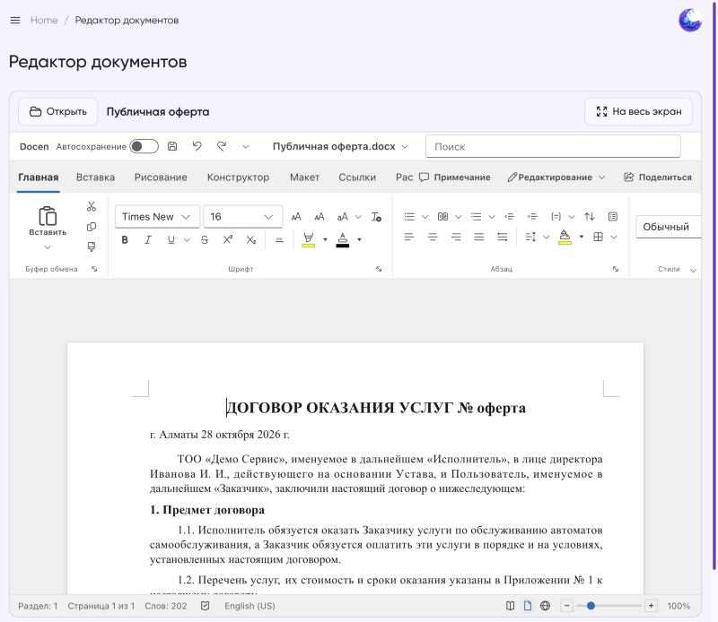
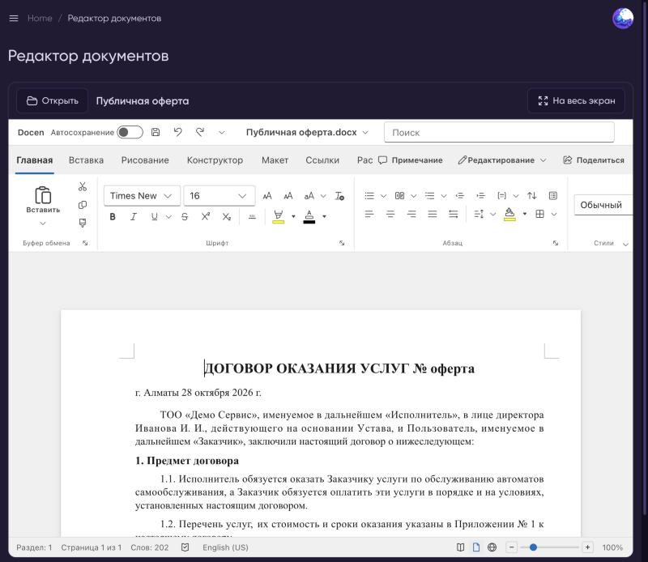
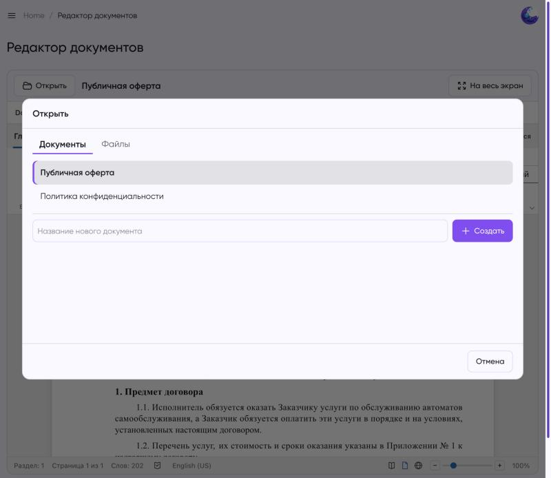
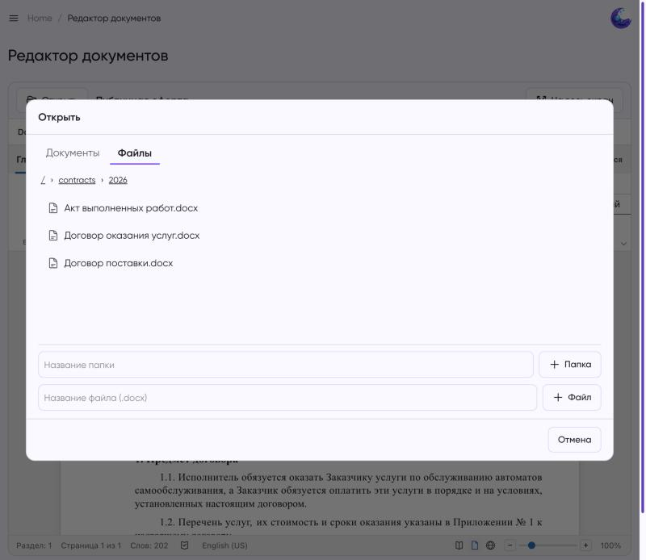
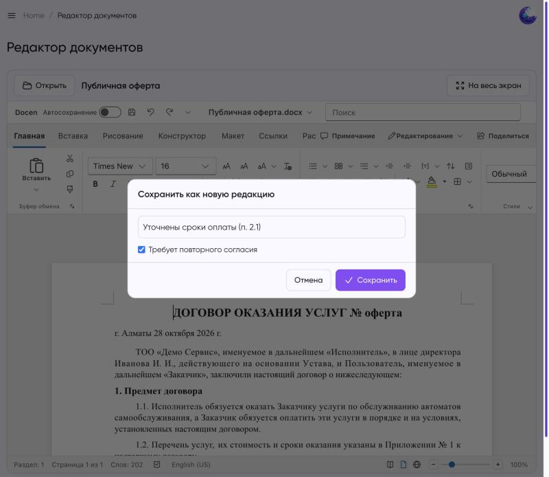

# Moonshine Docx Editor

[](https://moonshine-laravel.com)

WYSIWYG-редактор `.docx` прямо в админке [MoonShine](https://moonshine-laravel.com). Открывает файл в браузере, правки сохраняются как новая редакция. Редактор — веб-компонент [docen](https://github.com/DemoMacro/docen) (`<docen-document>`), серверный Office не нужен.

| Светлая тема | Тёмная тема |
|---|---|
|  |  |

**Выбор документа и просмотр хранилища по папкам**

| Документы | Файлы |
|---|---|
|  |  |

**Сохранение как новая редакция**



> docen до версии 1.0 нестабилен (так написано в его README). Версия в пакете зафиксирована: `@docen/editor` 0.7.0. Проверяйте свои документы на сохранение форматирования до боевого использования.

## Требования

| | Версия |
|---|---|
| PHP | 8.2+ |
| Laravel | 10, 11, 12, 13 |
| MoonShine | 4.x |

## Установка

```bash
composer require zhandos717/moonshine-docx-editor
php artisan vendor:publish --tag=moonshine-docx-editor-config
php artisan vendor:publish --tag=moonshine-docx-editor-assets
```

Собранный JS-бандл (~3,7 МБ, ~1 МБ в gzip) лежит в `dist/` и публикуется в `public/vendor/moonshine-docx-editor`. `npm` на сервере не нужен. Ассеты также входят в тег `laravel-assets`: если в `composer.json` приложения есть `vendor:publish --tag=laravel-assets --force` (как в стандартном Laravel), они обновляются сами при `composer install/update`.

## Использование

Документы подхватываются из хранилища сами (`discover => true`), новые создаются прямо на странице (`allow_create => true`): введите название и нажмите «Создать». В редакторе доступны загрузка своего `.docx`, скачивание и сохранение как новая редакция.

Конфиг `documents` необязателен: через него можно задать красивые названия или закрепить документы, которых ещё нет в хранилище:

```php
'documents' => [
    'offer' => 'Публичная оферта',
    'privacy-policy' => 'Политика конфиденциальности',
],
```

В меню MoonShine появится страница «Редактор документов» (отключается `auto_menu => false`; тогда добавьте `DocxEditorPage::class` в меню сами). На ней переключатель документов, редактор, поле примечания, галочка «Требует повторного согласия» и кнопка «Сохранить как новую редакцию».

## Свое хранилище

По умолчанию каждая редакция пишется на диск Laravel: `docx-editor/{key}/{Y-m-d_His}.docx`, текущая — последняя. Чтобы хранить редакции в БД, вести журнал или привязывать согласия пользователей, реализуйте контракт и укажите класс в `storage`:

```php
use Zhandos717\MoonshineDocxEditor\Contracts\DocxStorage;

class LegalDocxStorage implements DocxStorage
{
    /** @return array<string, string> ключ => заголовок существующих документов */
    public function list(): array { /* ... */ }

    public function read(string $key): ?string { /* байты текущей редакции или null */ }

    public function write(string $key, string $contents, array $meta = []): array
    {
        // $meta: note, requires_reaccept, user
        return ['version' => '2026-10-28'];
    }
}
```

## Конфигурация

- `auto_menu` — добавлять страницу в меню автоматически
- `documents` — необязательный список ключ => заголовок
- `discover` — показывать все документы из `DocxStorage::list()`
- `allow_create` — разрешить создавать новые документы на странице
- `ability` — Gate-ability для доступа к редактору (`null` — любой авторизованный пользователь MoonShine); получает ключ документа
- `browser` — режим «Файлы» (по умолчанию выключен), `browser_directory` — его корень (отдельный от `directory`), `browser_create` — можно ли создавать файлы и папки, `files_ability` — Gate-ability для файлов (получает относительный путь, `null` — используется `ability`)
- `storage` — класс, реализующий `Contracts\DocxStorage`
- `disk`, `directory` — параметры стандартного хранилища
- `max_size_kb` — максимальный размер загружаемого файла (10240)

## Язык

Интерфейс редактора (лента, меню, диалоги) переводится на язык приложения: в docen встроены английский и китайский, русский добавляет пакет (`resources/js/ru.json`). Перевод сделан без носителя, замечания и правки приветствуются. Подписи самого пакета лежат в `resources/lang`.

## Известные ограничения

Проверка на трёх реальных договорах (226 абзацев, таблицы, выравнивание, отступы, шрифты, разрывы страниц): текст и структура сохраняются без потерь. Docen при сохранении теряет поля колонтитулов (`PAGE`, `NUMPAGES`: «Стр. 1 из 5»). Пакет это обходит: если колонтитул не правили, при сохранении возвращается оригинал (`resources/js/restore-fields.js`). Если колонтитул изменили в редакторе, в файл попадёт версия docen, то есть поля в нём пропадут. Также не сохраняются тема документа (`word/theme`) и свойства файла (`docProps`).

## Безопасность

По умолчанию редактировать документы может любой пользователь админки. Ограничьте это через `ability`:

```php
// config/docx-editor.php
'ability' => 'edit-legal-documents',

// AppServiceProvider
Gate::define('edit-legal-documents', fn ($user, $key = null) => $user->moonshine_user_role_id === 1);
```

Маршруты `docx-editor/{key}/file` и `docx-editor/{key}` закрыты middleware авторизации MoonShine. Ключ документа проверяется по списку `documents`, содержимое по сигнатуре DOCX (ZIP).

## Сборка ассетов (для разработчиков пакета)

```bash
npm install
npm run build   # dist/docx-editor.js
```

## Лицензия

MIT
